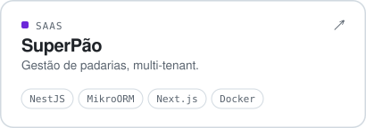

<picture>
  <source media="(prefers-color-scheme: dark)" srcset="assets/header-dark.svg">
  
</picture>

Analista de Sistemas na **B2ML**, em Itajubá (MG). Trabalho com backend em TypeScript: APIs em NestJS, modelagem em PostgreSQL, multi-tenant com RBAC e pipelines que barram código ruim antes do merge.

**Agora:** construindo o [ProLobby](https://github.com/ljborgess/ProLobby.com), matchmaking por posição e elo para EA FC Pro Clubs, com lobby coordenado por bot no Discord.

### Projetos

<a href="https://github.com/ljborgess/ProLobby.com"><picture><source media="(prefers-color-scheme: dark)" srcset="assets/prolobby-dark.svg"></picture></a>
<a href="https://github.com/ljborgess/SaaSuperPao"><picture><source media="(prefers-color-scheme: dark)" srcset="assets/superpao-dark.svg"></picture></a>
<a href="https://github.com/ljborgess/skills"><picture><source media="(prefers-color-scheme: dark)" srcset="assets/skills-dark.svg"></picture></a>
<a href="https://github.com/ljborgess/ByMySelf"><picture><source media="(prefers-color-scheme: dark)" srcset="assets/portfolio-dark.svg"></picture></a>

Também: [cinedex](https://github.com/ljborgess/cinedex), catálogo de filmes em Django com contas por usuário, busca com filtros, exportação CSV e testes · [AcessCore.js](https://github.com/ljborgess/AcessCore.js), RBAC em Node.js · [javascript-hard-training.js](https://github.com/ljborgess/javascript-hard-training.js), treino de JS por níveis.

### Stack

**Backend** `TypeScript` `NestJS` `PostgreSQL` `MikroORM` `Python` `Django`  
**Front** `Next.js` `React` `Tailwind` `GSAP`  
**Infra** `Docker` `Turborepo` `GitHub Actions`

[Portfólio](https://by-my-self.vercel.app) · [LinkedIn](https://www.linkedin.com/in/lucianojunqueira/) · [E-mail](mailto:lucianoborges04@hotmail.com)
