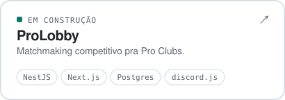
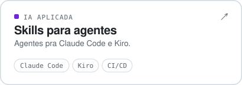
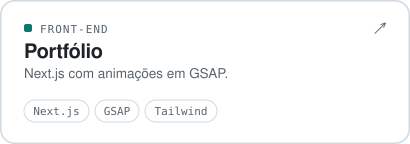

<picture>
  <source media="(prefers-color-scheme: dark)" srcset="assets/header-dark.svg">
  
</picture>

<a href="https://github.com/ljborgess/ProLobby.com"><picture><source media="(prefers-color-scheme: dark)" srcset="assets/prolobby-dark.svg"></picture></a>
<a href="https://github.com/ljborgess/SaaSuperPao"><picture><source media="(prefers-color-scheme: dark)" srcset="assets/superpao-dark.svg"></picture></a>
<a href="https://github.com/ljborgess/skills"><picture><source media="(prefers-color-scheme: dark)" srcset="assets/skills-dark.svg"></picture></a>
<a href="https://github.com/ljborgess/ByMySelf"><picture><source media="(prefers-color-scheme: dark)" srcset="assets/portfolio-dark.svg"></picture></a>

`TypeScript` `NestJS` `Next.js` `PostgreSQL` `MikroORM` `Docker` `Turborepo` `GitHub Actions`

[LinkedIn](https://www.linkedin.com/in/lucianojunqueira/) · [E-mail](mailto:lucianoborges04@hotmail.com)
